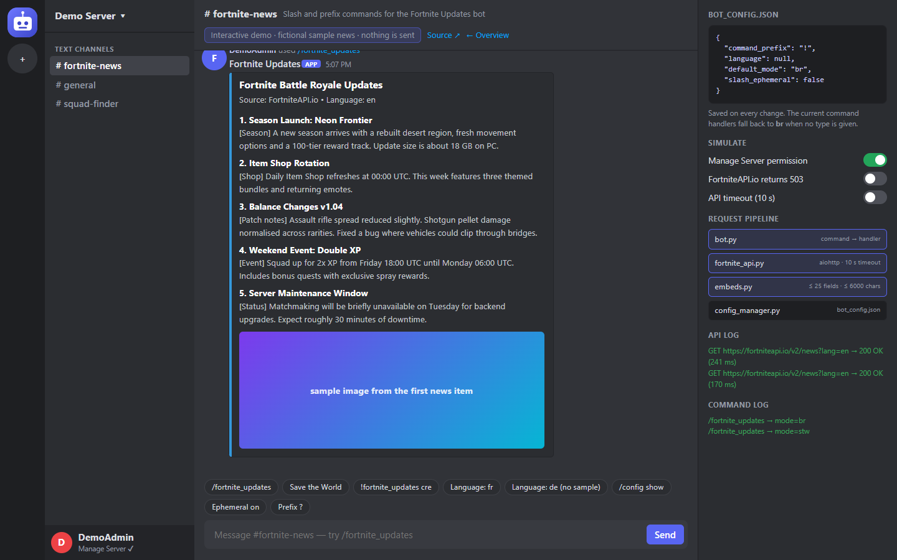

<div align="center">


# Fortnite Updates Discord Bot

**Fortnite news as clean Discord embeds — slash and prefix commands for Battle Royale, Save the World and Creative.**

[](https://248tech.github.io/fortnite-updates-bot/demo/)

[](LICENSE)
[](https://github.com/248Tech/fortnite-updates-bot/commits/main)
[](https://github.com/248Tech/fortnite-updates-bot/stargazers)
[](https://github.com/248Tech/fortnite-updates-bot/issues)


[**Live demo**](https://248tech.github.io/fortnite-updates-bot/demo/) · [Project site](https://248tech.github.io/fortnite-updates-bot/) · [Setup](#quick-setup-windows-powershell) · [Report a bug](https://github.com/248Tech/fortnite-updates-bot/issues)



</div>

> **Try it without a Discord server:** the [live demo](https://248tech.github.io/fortnite-updates-bot/demo/) simulates a channel and runs the bot's command logic in your browser, with fictional sample news. Unofficial fan tool, not affiliated with Epic Games or Discord.

A minimal, modular Discord bot that posts Fortnite updates using `discord.py`, `aiohttp`, and `FortniteAPI.io`.

### Features
- Legacy command: `!fortnite_updates [br|stw|cre]` (default: `br`)
- Slash command: `/fortnite_updates type: br|stw|cre`
- Async HTTP calls via `aiohttp` with timeout and robust error handling
- Clean separation of concerns:
  - `fortnite_api.py`: API client
  - `embeds.py`: embed formatting
  - `bot.py`: Discord command handling
  - `config_manager.py`: persistent config (`bot_config.json`)
- Reads config from `.env` (uses `python-dotenv`)

### Quick setup (Windows PowerShell)
```bash
.\setup.ps1 -Run
```
This will create a virtual environment, install dependencies, prompt you for `.env`, create `bot_config.json`, and start the bot.

### Quick setup (macOS/Linux)
```bash
chmod +x setup.sh
./setup.sh --run
```

### Requirements
- Python 3.10+
- A Discord bot token
- A `FortniteAPI.io` API key

### Setup
1. Clone or copy this project.
2. Create and activate a virtual environment.
   - Windows PowerShell:
     ```bash
     python -m venv .venv
     .\.venv\Scripts\Activate.ps1
     ```
   - macOS/Linux:
     ```bash
     python3 -m venv .venv
     source .venv/bin/activate
     ```
3. Install dependencies:
   ```bash
   pip install -r requirements.txt
   ```
4. Create a `.env` file in the project root with:
   ```bash
   DISCORD_TOKEN=your_discord_bot_token
   FORTNITE_API_KEY=your_fortniteapi_io_key
   NEWS_LANGUAGE=en
   ```
   - Language defaults to `en` if omitted.
5. Run the bot:
   ```bash
   python bot.py
   ```
6. Optional: Configure at runtime (requires Manage Server permission):
   - Slash: `/config show`, `/config set_language en`, `/config set_default_mode br`, `/config set_ephemeral true`, `/config set_prefix !`
   - Legacy: `!setprefix ?`, `!setlang en`, `!setmode br`, `!setephemeral true`

### Usage
- Legacy command in any text channel your bot can read:
  - `!fortnite_updates`
  - `!fortnite_updates stw`
  - `!fortnite_updates cre`
- Slash command in any server where your bot is present:
  - `/fortnite_updates` (choose type)

### Notes
- The bot fetches news from `FortniteAPI.io` and formats results into Discord embeds, honoring Discord limits (6000 chars, 25 fields).
- Errors are logged and a user-friendly message is sent if something goes wrong.


